```{r setup, include = FALSE}
knitr::opts_chunk$set(
  collapse = TRUE,
  comment = "#>",
  fig.align = "center",
  out.width = "80%",
  echo = FALSE
)
```

## Background

With v0.14.0, the **shiny** R package introduced a way to investigate the activity and logic of a **shiny** application through a visualization of it's reactive history. In version v1.3.0, **shiny** revamped this visual tool via the R package **reactlog**. The design and capabilities of this interactive visualization have vastly improved, especially for navigating large and complex reactive graphs. This vignette outlines the new design and helps explain how to navigate the new interface.

To understand **reactlog**, it helps to have a basic understanding of **shiny**'s reactive programming model. If you're fairly new to **shiny** and reactive programming, the next section, which has been modified from the [_Mastering Shiny_ book by Hadley Wickham](https://mastering-shiny.org/), provides an overview of **shiny**'s reactivity model and is designed specifically for understanding **reactlog**. You'll notice the terminology, concepts, and graphics are consistent with **reactlog**, which is introduced in the [Hello Reactlog](#reactlog) section with an example app. Heavy users of **reactlog** may find the [Reactlog in detail](#reactlog-in-detail) section helpful to detailing all the individual components of the **reactlog** interface. Finally, the [Learn more](#learn-more) section has links to more resources for learning even more about reactivity in **shiny**.

## The reactive life cycle {#reactivity}

### A reactive graph

Below is a diagram of a reactive graph. The shapes on the left are reactive inputs (or values), the ones in the middle are reactive expressions, and on the right are observers (or outputs). The lines between the shapes are directional, with the arrows indicating the direction of their inter-dependencies. When a **shiny** app is loaded, this graph is discovered and formed. When a user interacts with the app and changes reactive input values, the graph is partially deconstructed and then reformed. The sub-sections that follow explain how this reactive life cycle works in detail. The **reactlog** visualization is designed to help you inspect each particular step in this reactive life cycle.

```{r}
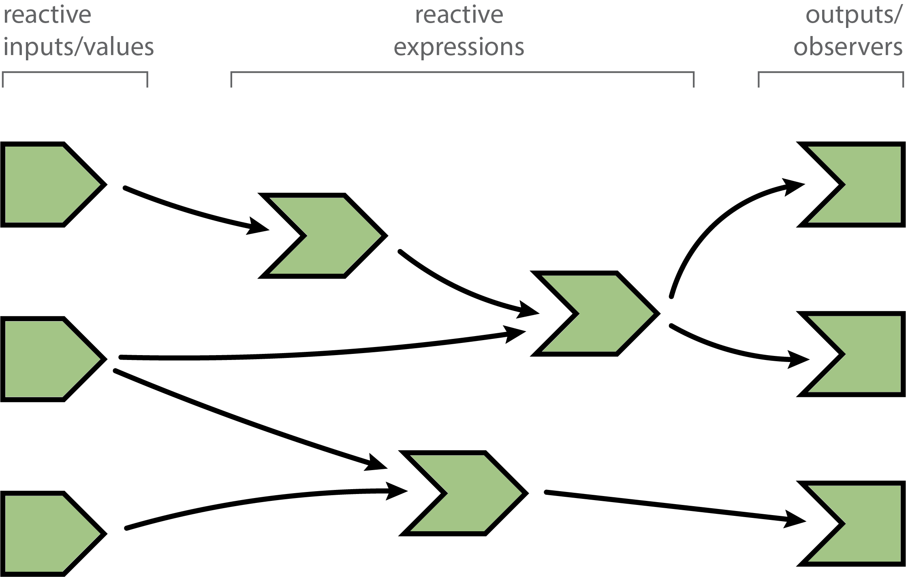
```

### A session begins

When you load a **shiny** app, all reactive expression and observers begin in an _invalidated_ state (indicated in gray). Invalidated state essentially means that any code that the node depends upon needs to be re-executed.

```{r}
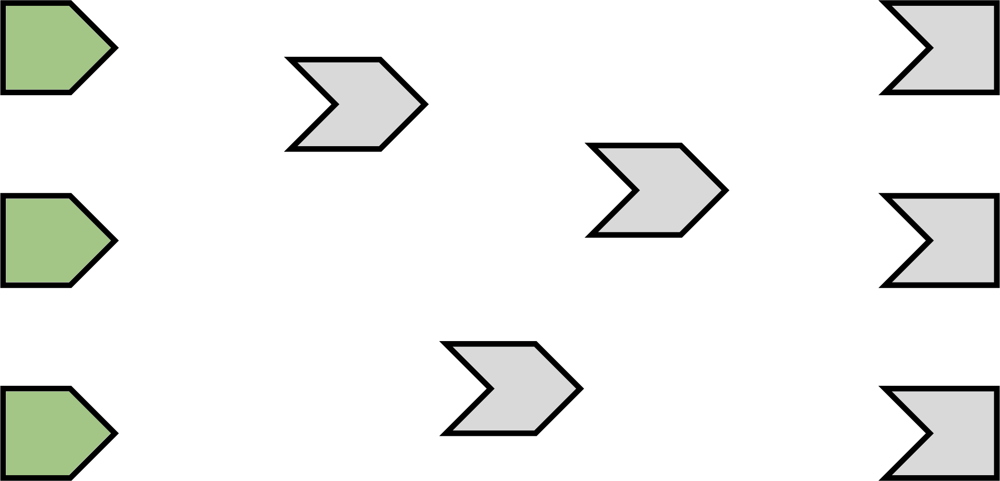
```

### Execution begins

After initializing a session, **shiny** picks an observer (_not_ a reactive expression) and starts executing it.^[You may wonder how Shiny decides which of the several invalidated observers/outputs to execute. The short answer is that you should act as if it's random. Ideally, your observers and especially outputs won't care what order they execute in, as each will function independently from the others. However, if you do have observers whose side effects must always happen in a certain relative order, you can use the `observe` function's `priority` argument to dictate that order for observers. You can also control the priority of outputs by calling the `outputOptions()` function with a `priority` argument.] Reactlog uses an orange fill to indicate when a node is actively executing (i.e., calculating).

```{r}
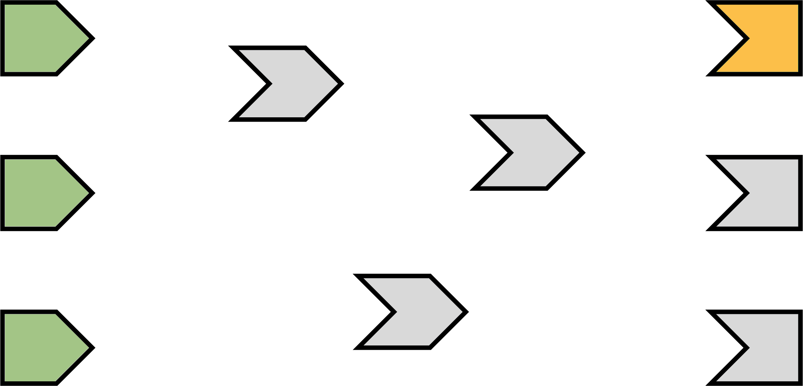
```

### Reading a reactive expression

During an observer's execution, it may read one or more reactive expressions. As soon as this occurs, the observer becomes dependent on the reactive expression, represented below by the new arrow.

Remember that all reactive expressions start out in invalidated state (represented by the gray fill), including the one this observer is now trying to access. In order to return a value, the reactive expression needs to execute its code, which it starts doing now. We fill the reactive expression with orange to represent that it's running.

Note that the observer is still orange: just because the reactive expression is now running, doesn't mean that the observer has finished. The observer is waiting on the reactive expression to return its value so its own execution can continue, just like a regular function call in R.

```{r}
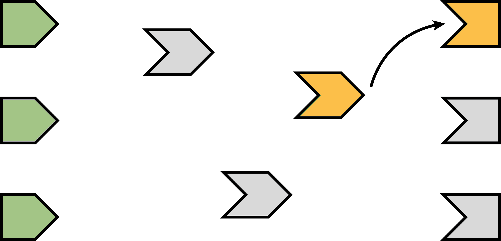
```

### Reading an input

This particular reactive expression happens to read a reactive input. Therefore, the reactive expression depends on the input, represented below by the arrow.

Unlike reactive expressions and observers, reactive inputs simply hold a value, so they don't require an execution phase (i.e., their value is ready from the start).

```{r}
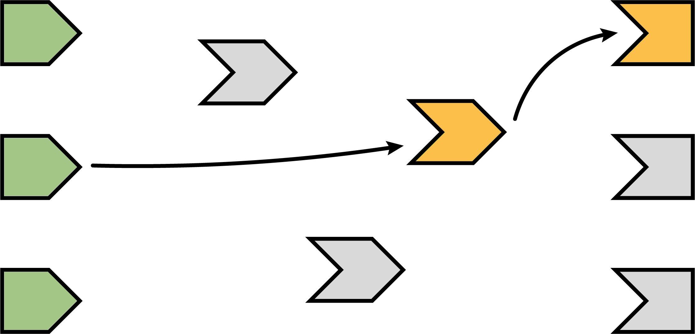
```

### Reactive expression completes

In our example, the reactive expression reads another reactive expression, which in turn reads another input. We'll skip over the blow-by-blow description of those steps, since they're just a repeat of what we've already described.

When the reactive expression has completed executing, it saves (caches) the resulting value internally before returning it to the observer that requested it. Now that the reactive expression has finished executing, it's no longer in invalidated (gray) or running (orange) state; rather, it's in idle/ready (green) state. When a reactive expression reaches this state, it means it's up-to-date and will not re-execute its code even if other reactive expressions or observers request its value. Instead, it can instantly return the value it cached during its most recent execution.

```{r}
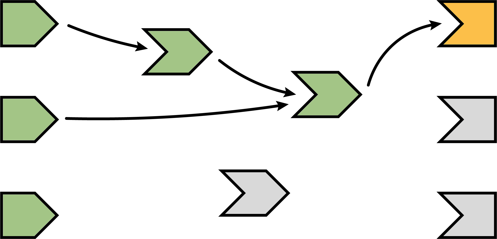
```

### Observer completes

Now that the reactive expression has returned its value to the observer, the observer can complete executing its code. When this has completed, it too enters the idle state, so we change its fill color to green.

```{r}
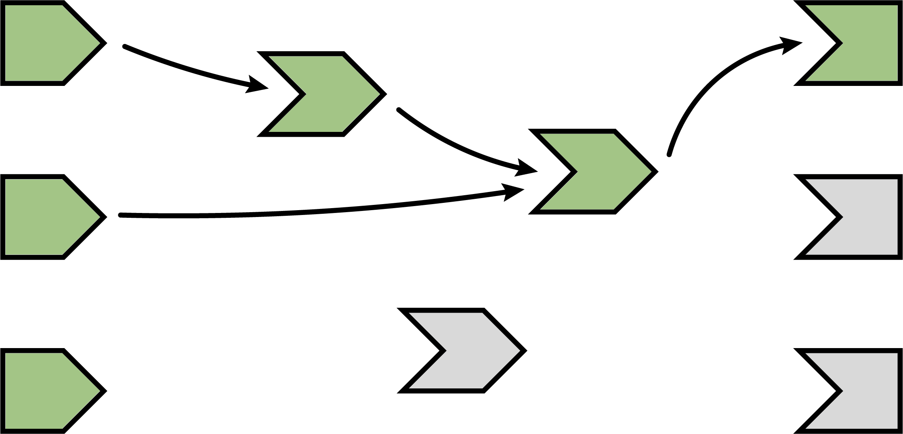
```

### The next observer executes

Now that Shiny has completed execution of the first observer, it chooses a second one to execute. Again, it turns orange, and may read values from reactive expressions, which will turn orange, and so on. This cycle will repeat until every invalidated observer enters the idle/ready (green) state.

```{r}
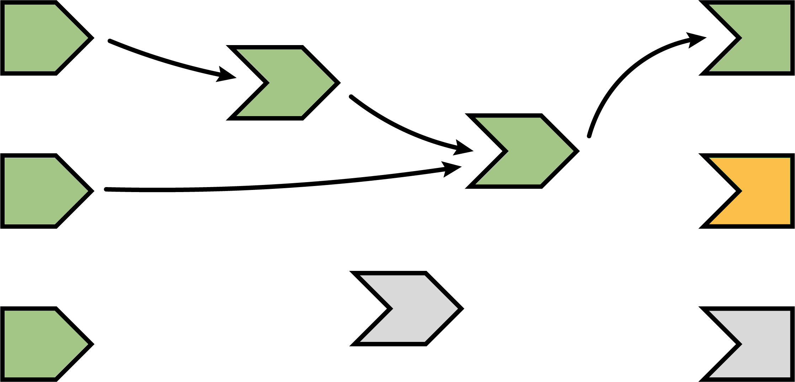
```

> As shown in the next diagram, the second observer in this particular graph depends on an idle reactive expression, so it can simply access it's cached value without performing redundant and possibly costly re-execution.

### Execution completes, outputs flushed {#reactive-flush}

At last, all of the observers have finished execution and are now idle. This round of reactive execution is complete, and nothing will happen with this session until some external force acts on the system (e.g. the user of the Shiny app moving a slider in the user interface). In reactive terms, this session is now at rest.

```{r}
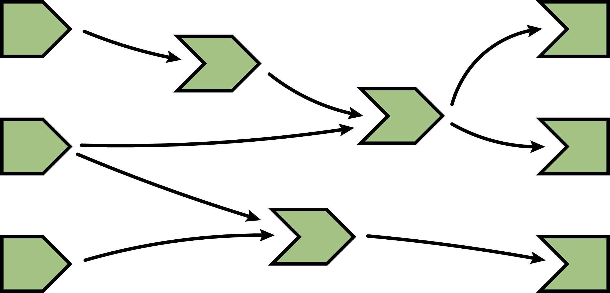
```

Let's stop here for just a moment and think about what we've done. We've read some inputs, calculated some values, and generated some outputs. But more importantly, in the course of doing that work, we also discovered the _relationships_ between these different calculations and outputs. An arrow from a reactive input to a reactive expression tells us that if the reactive input's value changes, the reactive expression's result value can no longer be considered valid. And an arrow from a reactive expression to an output means that if the reactive expression's result is no longer valid, then the output's previous result needs to be refreshed.

Just as important: we also know which nodes are _not_ dependent on each other. If no path exists from a particular reactive input to a particular output (always traveling in the direction that the arrows are pointing), then a change to that input couldn't possibly have an effect on that output. That gives us the ability to state with confidence that we don't need to refresh that output when that input changes, which is great--the less work we need to do, the sooner we can get results back to the user.

### An input changes

The previous step left off with our Shiny session in a fully idle state. Now imagine that the user of the application changes the value of a slider. This causes the browser to send a message to their server, instructing Shiny to update the corresponding reactive input.

When a reactive input or value is modified, it kicks off an _invalidation phase_, which we haven't seen up to this point. The invalidation phase starts at the changed input/value, which we'll fill with gray, our usual color for invalidation.

```{r}
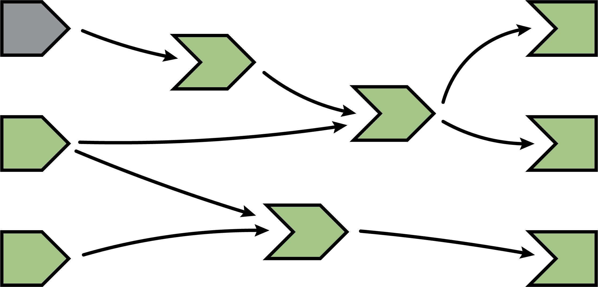
```

### Notifying dependents

Now, we follow the arrows that we drew earlier. Each reactive expression and observer that we come across is put into invalidated state, then we continue following the arrows out of that node. As a refresher, for observers, the invalidated state means "should be executed as soon as Shiny gets a chance", and for reactive expressions, it means "must execute the next time its value is requested".

In this diagram, the arrows in the lighter shade indicate the paths we took from the changed reactive input through the reactive graph. Note that we can only traverse the arrows in their indicated direction; it's impossible to move from a reactive expression leftwards to a reactive input, for example.

```{r}
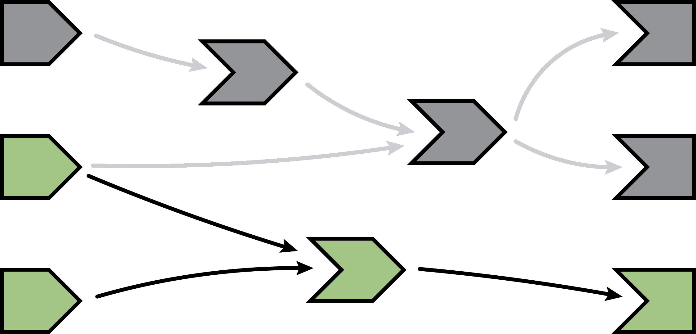
```

### Removing relationships

Next, each invalidated reactive expression and observer "erases" all of the arrows coming in or out of it. You can think of each arrow as a one-shot notification that will fire the next time a value changes. Not _every_ time, just _the next_ time. So all of the arrows coming _out_ of a reactive expression are safe to erase; like a used bottle rocket, they've fired their one shot.

(Less obvious is why we erase the arrows coming _in_ to an invalidated node, even if the node they're coming from isn't invalidated. While those arrows represent notifications that haven't yet fired, the invalidated node no longer cares about them. The only reason nodes care about notifications is so they can be invalidated; well, that invalidation has already happened due to some other dependency.)

```{r}
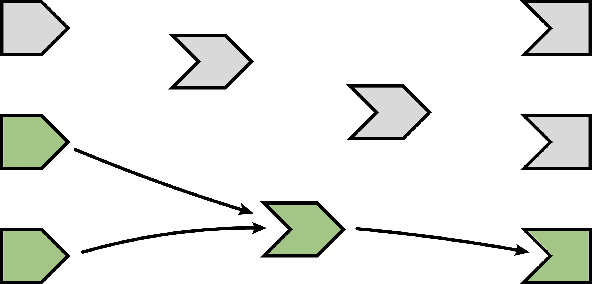
```

It may seem perverse that we put so much value on those relationships, and now we're going out of our way to erase them! But the truth is, though these particular arrows _were_ important, they are now themselves out of date. The only way to ensure that our graph stays accurate is to erase arrows when they become stale, and let Shiny rediscover the relationships around these nodes as they re-execute.

This marks the end of the invalidation phase.

### Re-execution

Now we're in a pretty similar situation to when the Shiny session first started; we have some invalidated reactive expressions and outputs, and we don't have any arrows coming in or out of them. It's time to do exactly what we did then: execute the invalidated outputs/observers, one at a time.

```{r}
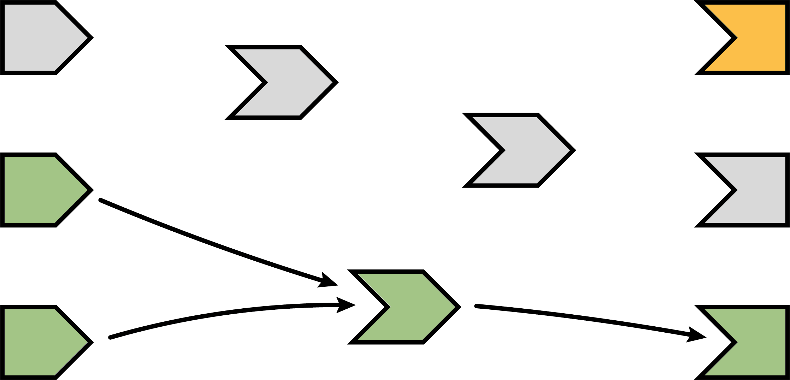
```

What's different this time, though, is that not all of the reactive expressions and outputs are starting out in the invalidated state. Some parts of the graph weren't affected--neither directly nor indirectly--by the reactive input that had changed. That's great, as we won't need to re-execute those parts of the graph, even if they are used again by some of the invalidated parts!


## Hello Reactlog {#reactlog}

Consider the following **shiny** app with one reactive input and one output. It simply allows you to choose variables from the `diamonds` dataset to visualize that variable using **plotly**.

```r
library(shiny)
library(reactlog)
library(plotly)

reactlog_enable()

ui <- fluidPage(
  selectInput("var", "Choose a variable", choices = names(diamonds)),
  plotlyOutput("plot")
)

server <- function(input, output, session) {
  output$plot <- renderPlotly({
    plot_ly(x = diamonds[[input$var]])
  })
}

shinyApp(ui, server)
```

While the app is running, change the selected variable and press `Ctrl+F3` (`Cmd+F3` on a Mac). After the app stops, you can open the recording with `reactlog_show()`.

## Reactlog in detail {#reactlog-in-detail}

Try the [cranwhales report](https://rstudio.github.io/reactlog/demo/reactlog.html) to explore a recorded app.

### Timeline {#status-bar}

Drag the timeline to replay the graph at a particular step. Use the left and right arrows to step between visible events, or press Space to play and pause. The timeline marks output calculations, idle points, bookmarks, and errors. Select the legend beside the timeline to see what the colors mean.

### Dependency graph {#dependency-graph}

Search for a reactive input, expression, or output by name. Select a node to highlight its dependencies. The inspector shows which inputs changed and which calculations and outputs ran during that round of updates. Open graph settings to switch between the current activity and the full graph.

### Keyboard shortcuts {#keyboard-shortcuts}

Use Home and End to jump to the beginning and end. Shift with the left or right arrow jumps between idle points. Press `?` to see the full shortcut list.

## Learn more {#learn-more}

This vignette explains the **reactlog** interface, which requires a basic understanding of **shiny** and reactive programming. There are many other useful existing articles and resources that may help advance your understanding of **reactlog** and **shiny**, including but not limited to:

* The core **shiny** articles under [Build Reactivity](https://shiny.rstudio.com/articles/#reactivity), these articles help explain:
    * How reactive elements know about each other
    * When elements are calculated
    * Why a `clientData` is randomly appearing in the reactive graph
    * How to prevent reactivity from executing using `isolate()`
* The **shiny** [tutorials](https://shiny.rstudio.com/tutorial/), which provides many great instructional videos and various learning resources.
* The `rstudio::conf2019` talk by Barret Schloerke: _Reactlog 2.0: Debugging the State of Shiny_ ([Video](https://www.rstudio.com/resources/rstudioconf-2019/reactlog-2-0-debugging-the-state-of-shiny/) / [Slides](https://github.com/schloerke/presentation-2019-01-18-reactlog/blob/master/rstudio-conf-2019-reactlog.pdf)).
* Effective Reactive Programming [Part 1](https://www.rstudio.com/resources/shiny-dev-con/reactivity-pt-1-joe-cheng/)) [Part 2](https://www.rstudio.com/resources/shiny-dev-con/reactivity-pt-2/):
  * "This tutorial will go beyond the basics, explaining the philosophy behind Shiny’s reactive programming framework and exploring patterns and techniques for using it well."
* [Mastering Shiny](https://mastering-shiny.org) by Hadley Wickham
